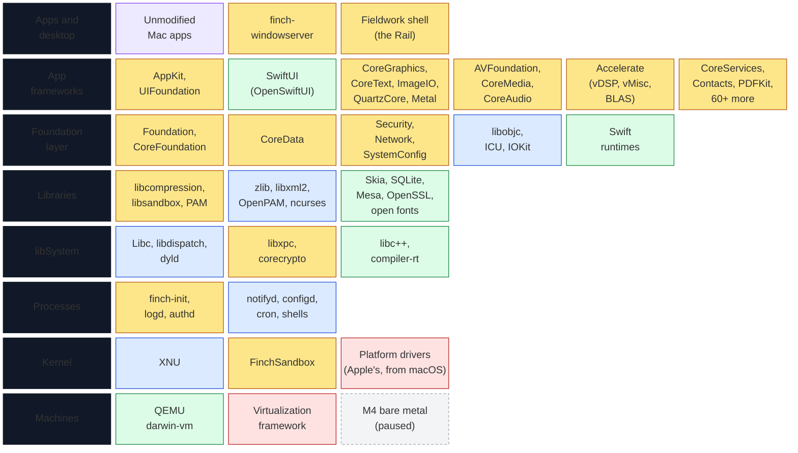
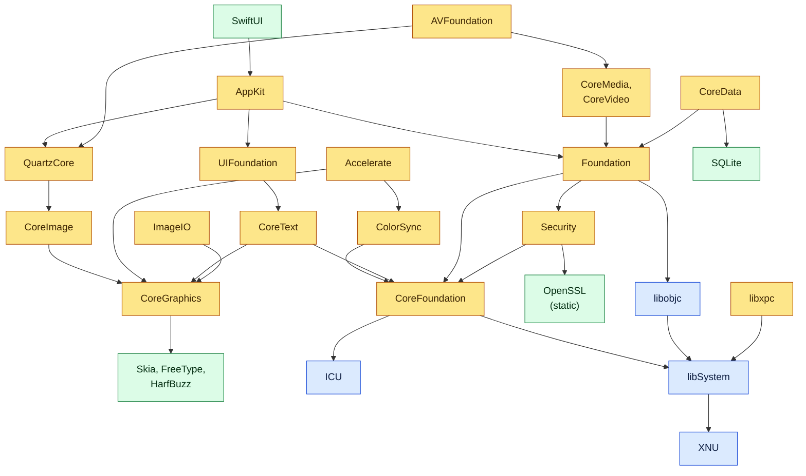

# Finch software stack

What runs on Finch today and where each piece comes from, bottom to top.
[ARCHITECTURE.md](ARCHITECTURE.md) explains the layers, [ROADMAP.md](ROADMAP.md) what
comes next and where the release stands, and the design notes in `docs/design/` each
component's details and limits. Every commit that adds, replaces or removes a component
updates this page; `tools/render-stack.sh` checks that the diagrams render.

**As of 2026-10-27:** Accelerate is laid out as Apple's and has all of vDSP, vMisc
(vForce, vfp, vBasicOps, vBigNum) and BLAS, and vImage all but its CoreVideo utilities; Network has its C API; CoreData reads
and writes macOS's XML and binary stores.

## Layers

| Colour | Meaning |
|---|---|
| Yellow | Written by Finch |
| Blue | Apple's open source, built by Finch (pinned tags, `userland/projects.txt`) |
| Green | Third-party open source, built by Finch |
| Red | Apple's binaries used from the user's macOS at run time, never redistributed |
| Purple | Unmodified Mac apps, from macOS, for testing |
| Grey, dashed | Planned |

## How the main libraries link

Load-time links between the main pieces (`otool -L`), simplified: links to
libSystem and libobjc are left out except at the bottom.

## Components

Per-framework API coverage is in [COMPATIBILITY.md](COMPATIBILITY.md).

| Layer | Component | From | Notes |
|---|---|---|---|
| Apps | Apple's apps (Calculator, TextEdit, Stickies, Terminal, Grapher, Script Editor, Console, ...) | macOS, for testing | Run sandboxed in the VM on Finch's frameworks ([APPS.md](APPS.md)) |
| Desktop | finch-windowserver | Finch | Windows over shared memory, Skia compositor, cursor, input, window capture ([design](design/WINDOWSERVER.md)) |
| Desktop | Fieldwork shell: the Rail | Finch | Pinned and running apps, workbench switcher, app launcher ([design](design/FIELDWORK.md)) |
| App frameworks | AppKit, UIFoundation, Cocoa, ApplicationServices | Finch | Windows, views, controls, text (TextKit 1 and 2), nibs and storyboards, Auto Layout, bindings, panels, drag and drop, Fieldwork and Classic themes ([design](design/APPKIT.md)) |
| App frameworks | SwiftUI, SwiftUICore, Combine | OpenSwiftUI, OpenCombine + Finch | First app draws ([design](design/SWIFTUI.md)) |
| App frameworks | CoreGraphics, CoreText, ImageIO, ColorSync | Finch over Skia, FreeType, HarfBuzz | Drawing, PDF, fonts, image codecs, colour profiles ([design](design/COREGRAPHICS.md)) |
| App frameworks | QuartzCore, CoreImage, Quartz, ImageKit, QuartzFilters, CoreUI | Finch | Layers, filters on the CPU, asset catalogs |
| App frameworks | OpenGL, Metal, MetalKit | Finch over Mesa | Software OpenGL; Metal has no device yet |
| App frameworks | AVFoundation, AVFAudio, CoreMedia, CoreVideo, IOSurface, CoreAudio, AudioToolbox, AudioUnit, CoreMIDI, VideoToolbox, AVKit, MediaPlayer, ScreenCaptureKit | Finch (OpenH264, libvpx, dav1d static) | Assets, playback, readers and writers, audio files and conversion, software audio units ([media plan](design/MEDIA.md)) |
| App frameworks | Accelerate: vecLib (libvDSP, libvMisc, libBLAS, libLAPACK) and vImage | Finch | All of vDSP, vMisc and BLAS; vImage all but its CoreVideo utilities; LAPACK only the calls apps use ([design](design/ACCELERATE.md)) |
| App frameworks | CoreServices, UniformTypeIdentifiers, HIServices, Carbon/HIToolbox, PrintCore, OpenScripting, OSAKit | Finch | App lookup and launch, Apple events, AppleScript, printing to PDF |
| App frameworks | Contacts, ContactsUI, Intents, CoreSpotlight, CloudKit, LinkPresentation, PDFKit, Quick Look, Vision, GameController, WidgetKit, CoreBluetooth, CryptoTokenKit, MediaAccessibility, UserNotifications, CoreLocation, ServiceManagement, StoreKit, Accounts, SecurityInterface, AuthenticationServices, ImageCaptureCore, and more | Finch | Each answers as a Mac without the service or device would; limits in `docs/design/` |
| Foundation | Foundation, CoreFoundation, CoreAutoLayout | Finch | Objective-C, class for class ([design](design/FOUNDATION.md)) |
| Foundation | CoreData | Finch over SQLite | SQLite, XML, binary and custom stores; migration |
| Foundation | Security, SecurityFoundation, CryptoKit | Finch (OpenSSL, swift-crypto) | Keys, certificates, trust, keychains, code signatures ([design](design/SECURITY.md)) |
| Foundation | SystemConfiguration, CFNetwork, Network, OpenDirectory | Finch | Settings, URL loading, TCP/UDP/TLS/Bonjour (Swift and C API), accounts |
| Foundation | libobjc (objc4), libicucore, IOKit (IOKitUser), GCoreFramework | Apple open source | |
| Foundation | Swift runtimes and overlays, swift-system | Swift 6.3.1 | |
| Libraries | libcompression, libsandbox, pam_unix and Finch's PAM modules, libfinchaccount, libEndpointSecuritySystem | Finch | Sandbox profiles compiled from SBPL |
| Libraries | zlib, bzip2, libxml2, libedit, libresolv, libiconv, ncurses, OpenBSM, OpenPAM | Apple open source | |
| Libraries | Skia m155, FreeType, HarfBuzz, libpng, libjpeg-turbo, libwebp, SQLite 3.54.0, Mesa 25.0.7, cmark-gfm, lzfse, lz4, brotli, liblzma, tzdata, open fonts | Third-party open source | Fonts in place of Apple's, which can't ship |
| libSystem | Libc, libmalloc, libpthread, libplatform, libdispatch, Libinfo, Libnotify, dyld (with Finch's shared cache) | Apple open source | |
| libSystem | libxpc, libcorecrypto, libsystem_* (sandbox, trace, secinit, ...) | Finch | |
| libSystem | libc++, compiler-rt | LLVM | |
| Processes | finch-init, finch-logd, finch-pboardd, authd, finch-update, finch-setup, finch-distnoted, panel and dialog agents, scutil, networksetup, security, kextload | Finch | |
| Processes | notifyd, syslogd, configd, diskarbitrationd, mDNSResponder, cron, login, su, bash, zsh, file/shell/text/system commands | Apple open source | |
| Kernel | XNU xnu-12377.101.15 | Apple open source | |
| Kernel | FinchSandbox | Finch | Enforces compiled sandbox profiles |
| Kernel | Platform drivers | Apple's, from macOS | Finch's own are Phase 3 |
| Machines | QEMU darwin-vm (Tier 1), Virtualization.framework (Tier 2), M4 (Tier 3, paused) | | [DEV_VM.md](DEV_VM.md), [HARDWARE.md](HARDWARE.md) |
