# Finch software stack

What runs on Finch today and where each piece comes from, bottom to top.
`docs/ARCHITECTURE.md` explains the layers. `docs/ROADMAP.md` covers what comes next.
These diagrams are updated in every commit that changes the stack, and
`tools/render-stack.sh` checks that they render.

**Release status:** Finch 1.0 remains unfinished. The development VM uses a RAM
disk; persistent installation, boot recovery and supported-device checks remain
open. [The release checks](ROADMAP.md#finch-10-release-checks) separate those
requirements from library comparisons and app import counts.

**As of 2026-10-27:** CoreData runs custom persistent stores and macOS's XML and binary
store formats, migrates stores (lightweight and through mapping models) and computes
macOS's model version hashes; AppKit has NSPersistentDocument and NSTypesetter;
Network has its C API (`nw_*`) over the Swift one; Accelerate is laid out as Apple's
(vecLib with libvDSP, libvMisc, libBLAS and libLAPACK, and vImage) and has all of vDSP,
vMisc (vForce, vfp, vBasicOps, vBigNum) and BLAS.
`logger` (remote_cmds) sends syslog messages that reach the
unified log, as on macOS. Finch's sandbox is its own: `libsandbox.1` compiles macOS's
profile language (SBPL) and the `FinchSandbox` kernel policy enforces the compiled
profiles at file, process, sysctl, IPC, socket, IOKit and system-call hooks.
notifyd starts under its profile with no borrowed sandbox component, and
sandbox extensions are the kernel policy's own. Mach-trap filtering and network
address filters remain open (`docs/design/SECURITY.md`, "The sandbox"). Finch's own `scutil` and
`networksetup` set system and network settings; on the persistent VM those
survive restarts. A new system's first boot runs `finch-setup`, which makes the
first administrator account before login. Apps signed for the App Sandbox
start in their containers under Finch's `application.sb` (`libsystem_secinit`);
their open and save panels run in Finch's panel agent, which hands chosen files over.
Finch's `authd` shares authorization
rights and credentials between processes, asking for passwords in Finch's dialog
agent; administrators trust or distrust
certificates with Finch's `security` command. Disk Arbitration mounts a second
disk at startup through its filesystem kext, which Finch's `kextload` starts. `chpass`, `chsh` and `chfn` change
account details through Finch's OpenDirectory and its setuid account helper.
A persistent development VM (`tools/vm/mkpersistent.sh`) keeps accounts,
passwords, home folders and `/private/var/db` on a VirtIO data disk: `rc` mounts
it through `finch-data-volume` before services start, and a missing disk stops
startup. A new user, a changed password and saved files survived a shutdown
and two restarts (`tools/vm/test-persistence.sh`, 2026-10-25). The disk needs
Apple's AppleVirtualPlatform PCIe bridge kext, now linked into the kernel
collection, and the system image still loads into RAM
(`docs/design/PERSISTENT_VM_STORAGE.md`). The normal VM image boots from RAM.

Intents supplies SDK-declared data objects, typed initializers and
resolution results. It stores donated interactions in
`~/Library/Finch/Intents/interactions.archive`. Its host comparison matches Apple's for
the values it covers, and a separate check reads and clears a saved interaction. Finch
has no Siri or voice-shortcut service. Its API audit finds 545 of 1,065 items; most
missing names have no public declaration in the macOS SDK (`docs/design/INTENTS.md`).
Six small framework images now cover app imports for MediaPlayer, MediaAccessibility,
CoreBluetooth, `libsandbox.1.dylib`, CryptoTokenKit, and WidgetKit. Together they expose
712 of 1,433 API items. Host comparisons cover their now-playing values and artwork,
caption defaults, Bluetooth identifiers and GATT values, sandbox checks and extension
tokens, token TLV records and PIN formats, and WidgetKit timelines and no-host results.
Finch has no media-key route, Bluetooth radio, card reader, or widget
host. `Widget` and `WidgetConfiguration` still need Finch SwiftUI support. Details and
test boundaries are in `docs/design/SMALL-FRAMEWORKS.md`.
GameController builds from the macOS SDK headers, without shipping
Apple headers. Snapshot gamepads have working button and direction-pad state. AppKit's
local event stream feeds Finch's keyboard and mouse input objects. The API audit finds
545 of 907 items, and its focused host comparison matches Apple's. Finch IOKit cannot
enumerate HID devices, so physical controllers, their battery and light data, and haptics
are unavailable; `GCVirtualController` is not available on macOS. The app sweep now finds
GameController imports missing from 7 apps, down from 10.
PDFKit reads pages and annotations through Finch CoreGraphics,
extracts and searches text with CoreText font maps, reads and writes outlines, and shows
documents in AppKit PDF views. It saves simple URL links and refuses a changed document
when it cannot preserve an annotation. Its API audit finds 371 of 562 public items.
PDFKit and AVKit use the macOS SDK headers to build, without copying them into Finch.
AVKit shows AVPlayer content with basic playback controls and full-screen mode. Finch has
no external playback routes or picture-in-picture window service, so those features stay
unavailable. The PDFKit and AVKit host comparisons match Apple's. VideoToolbox moves pixels between Finch's CoreVideo buffers,
rotates them, decodes H.264, VP8, VP9 and AV1, and encodes H.264 through open static
codecs. Its comparison test checks pixel operations exactly and allows up to 16 levels
of difference in each average decoded RGB channel. CoreData reads compiled models and
supports basic SQLite and in-memory stores, contexts, fetches, and to-one relationships.
CloudKit implements local records, zones, shares, subscriptions, notification parsing,
operation settings and saved sync state. Finch has no iCloud service, so account checks
report no account and remote work returns an error. Its host comparison matches Apple's
for the tested data models; 509 of 1,208 public API items are present, with the rest still
missing (`docs/design/CLOUDKIT.md`). ContactsUI presents a contact picker and card over Finch Contacts; CoreSpotlight stores
searchable items in a local index and runs queries; LinkPresentation fetches page metadata through
Foundation and shows it in an AppKit card. CryptoKit is built
from swift-crypto 5.0.1, with BoringSSL and
XKCP linked privately; fixed-key host comparisons cover its hashes, HMAC, HKDF,
AES-GCM, ChaChaPoly, and P-256, P-384 and Curve25519 keys and signatures. Nothing
Finch builds links a closed library (`tools/check-closed.py`). MetalKit now keeps
MTKView settings even though Finch has no GPU; AudioUnit re-exports AudioToolbox, and
CoreMIDI sends virtual endpoint packets inside a process. OpenAL remains out because
Finch has no audio output device. VideoToolbox reports no hardware codec support. Finch's own
Foundation covers about 140 of Apple's
classes, on a CoreFoundation that dispatches to Objective-C objects as Apple's
does (`docs/design/FOUNDATION.md`); its Markdown constructors use cmark-gfm,
linked privately into Foundation, and its NSXMLParser and NSXMLDocument read
with Apple's libxml2, built by Finch. Finch's CoreGraphics has begun, over Skia
(`docs/design/COREGRAPHICS.md`): bitmap contexts draw paths, images,
clips, shadows and transparency layers as Apple's do, PDF contexts write
through Skia's PDF backend, and Finch's own parser reads and draws PDF. Finch's ImageIO reads
PNG, JPEG, GIF, BMP, ICO and WebP and writes PNG and JPEG over the open
codecs Skia builds, and reads and writes TIFF with its own codec, returning the CGImages and properties Apple's does. Finch's Accelerate (`docs/design/ACCELERATE.md`) has Apple's layout (the umbrella re-exports vecLib, whose libvDSP, libvMisc, libBLAS and libLAPACK, and vImage) and all of vDSP, vMisc (vForce, vfp, vBasicOps, vBigNum) and BLAS, with the vImage and LAPACK calls apps on this Mac import today, using Finch's own CPU routines. It does not yet include BNNS, the rest of vImage, or LAPACK in full. CoreText lays out text with HarfBuzz, FreeType and ICU, as Apple's does,
in open fonts Finch ships in place of Apple's (Inter for the system
font, Open Runde for rounded text, Fragment Mono for SF Mono, XCharter for
Charter, and TeX Gyre Pagella for Palatino). Liberation stays for Helvetica,
Arial, Times and Courier; DejaVu for Menlo; Noto for other scripts and emoji.
DejaVu bold fills SF Mono's bold styles, which Fragment Mono lacks.
Finch's window server composites windows that apps draw with CoreGraphics
into shared memory, and routes input to them (`docs/design/WINDOWSERVER.md`).
Finch's AppKit (`docs/design/APPKIT.md`), split as Apple's is with a private
UIFoundation under it, runs windows on that server: views draw, events reach
them, nibs and storyboards load, and full-size content windows show their title
bars and nib-loaded toolbars. `NSTextView` uses TextKit 2 by default, with TextKit 1
available. Auto Layout solves constraints with Finch's own Cassowary solver, in
a private CoreAutoLayout that Foundation re-exports. Cocoa bindings, controllers,
alerts, sheets, open/save panels and NSWorkspace work. Their comparison tests,
including TextKit 2 and Auto Layout, match Apple's on the host and in the VM.
AppKit and the window server draw in Fieldwork, Finch's own design language
(`docs/design/FIELDWORK.md`), from a theme file of tokens; the Classic theme keeps
Aqua-compatible values for apps that need them and for the comparison tests.
Combine is open code (OpenCombine with Finch's additions) built to Apple's ABI
(`docs/design/COMBINE.md`), as is Swift System (swift-system, all of Apple's
`libswiftSystem` exports). SwiftUI is built from OpenSwiftUI, renamed to Apple's
modules, on Compute's attribute graph and the Swift runtime's Observation (apps'
`@Observable` types work with it); an unmodified SwiftUI app built with Xcode draws
its window on Finch's frameworks (`docs/design/SWIFTUI.md`); the frameworks it links that Apple keeps closed are Finch's own:
CoreVideo's display link, Accessibility, CoreTransferable and DeveloperToolsSupport. Terminal's need brought
CoreAudio (no devices until there's an audio driver), AudioToolbox's system sounds, Carbon with HIToolbox's
Carbon events and key translation, CoreAnalytics (which collects nothing), libScreenReader and
ColorSync (ICC profiles, Apple's named ones written by Finch and installed as the system's profiles, a device registry, and transforms over skcms),
HIServices (the accessibility client API, which reports no trust until Finch has an
accessibility server, Universal Access settings and the Process Manager) and
DataDetectorsCore (links, addresses, phone numbers and IP addresses found in text). With them, Apple's Terminal runs on Finch. Foundation carries the URL loading system
(file, data and HTTP(S) loading over OpenSSL, with cookies), and CFNetwork is Finch's own: HTTP
messages, authentication and streams, socket streams, CFHost, Bonjour over dns_sd,
proxy settings and FTP, matching Apple's in its comparison test. CoreImage is Finch's
own too: images are recipes rendered on the CPU in Apple's working space, and about seventy
of Apple's filters give Apple's pixels. Apps' status items, global hot keys and posted
Quartz events work through the window server; frameworks for services Finch doesn't have
yet (location, biometrics, Wi-Fi, Bluetooth, the App Store) answer as a Mac without them
would, so apps that link them run. CoreVideo's pixel buffers and pools are Finch's, laid out
byte for byte as Apple's are (in memory of their own or an IOSurface's), and CoreMedia's
times, block buffers, format descriptions (including those from H.264 and HEVC
parameter sets), sample buffers, clocks, timebases, queues, memory pools, metadata
identifiers and tags match Apple's in their comparison tests. AudioUnit.framework now
re-exports Finch's AudioToolbox at Apple's install name. CoreMIDI's client API keeps
virtual sources, destinations and ports in a process-local graph; there is no hardware
or system-wide routing. MetalKit keeps MTKView's settings, while texture
creation reports the missing Metal device. Its VM mesh check cannot run because
ModelIO is absent; mesh creation remains unverified there. OpenAL stays out while CoreAudio has
no output device. VideoToolbox moves pixels between Finch's CoreVideo buffers, scales
and rotates them, decodes H.264, VP8, VP9 and AV1, and encodes H.264 with statically
linked OpenH264, libvpx and dav1d.
OpenGL is Mesa's software
renderer (softpipe through OSMesa, built by Finch) under Finch's own CGL and GLU, and
AppKit's NSOpenGL views draw with it; AppKit's named system images and symbol images are Finch's own artwork; PrintCore is Finch's own (sessions, settings, page formats and papers, printing to PDF; no printers until there's a printing system), as are Quartz filters, which change a context's colours through CoreGraphics; windows draw into a back buffer that each flush copies to the window server; typedstream archives (NSArchiver) of AppKit's
colours, fonts, images, paragraph styles, shadows, paths and print info match Apple's. AppleScript is Finch's own
(`userland/OpenScripting`): a parser and interpreter for AppleScript's English dialect behind the Open
Scripting Architecture's calls, with OSAKit's script view and controller and NSAppleScript over them, and
`osascript`; compiled source, results, errors and their ranges match Apple's in their comparison test.
SwiftUI gained Settings scenes, group boxes, tab views, canvases (drawing through CoreGraphics),
outline lists, scene storage, search fields, inspectors, drop delegates and file exporters, and
NSFontCollection is in CoreText as Apple's is. The desktop's frame is the Instrument Bar (each app's menu bar) and the Rail, a
Finch app down the left edge that replaces the Dock.

CoreFoundation's local notification center shares observers with Foundation's
default `NSNotificationCenter`. Bundles read `.loctable` files and choose their
language using `AppleLanguages` and Apple's ICU matching. QuartzCore has layers
drawn through CoreGraphics, and AppKit's views can be layer-backed, animation objects and transactions. The layer test
matches Apple's on the host and in the VM; on-screen animation playback still
needs a render server.

CoreServices now includes local app lookup and launching, Apple event values
and local handlers, and filesystem helpers (`docs/design/CORESERVICES.md`).
CoreUI reads compiled asset catalogs for AppKit's named colors and images
(`docs/design/ASSETS.md`). Foundation also contains its Swift value types and
bridges, built from pinned Swift Foundation and Swift Collections sources.
The Darwin Swift overlays and AppKit's first Swift extensions build alongside it.
Security supplies keys, certificates, web and caller-root trust checks, file keychains,
code-signature checks and Secure Transport (TLS) over OpenSSL. Web roots come from
a pinned Mozilla bundle. New file keychains encrypt their contents and require a
password; process-local locking, unsafe-path refusal, changed-file rejection and
concurrent saves pass focused host and QEMU checks (2026-10-13). The per-user
keychain service also passes a QEMU check in which a second app reads an unlocked
keychain and locks out the first app. Authorization Services go through
Finch's `authd`: rights database, PAM password checks, credentials shared in a
session and privileged tools pass in QEMU.
SystemConfiguration reads local preferences and network state. Finch configd
shares store values and sends change callbacks between processes; user access
checks pass in QEMU. Settings watches recover after service restart; saved files
also survive service restart in a private test root. Disk Arbitration starts
and accepts client sessions. Apple's open-source FAT tools and basic mount/fsck
dispatchers now build. Manual loopback IPv4 and DNS apply pass in QEMU, including repeat apply.
Failed requests try to remove only newly added addresses; full undo remains open.
DNS-file restore after an apply error passes focused host and development VM
checks (2026-10-18), including failed syncs and an observed later writer. The
separate network settings flow also passes; crash and power-loss recovery remain open.
Added host checks also pass for failed path lookup and file replacement by another
writer immediately after the DNS rename. Those added cases also pass in the rebuilt VM.
The latest full development VM run passed all eight separate service checks.
Seven Apple comparisons remain unresolved with an offline host display, and the
borrowed sandbox compiler remains unverified; see the roadmap for the full counts.
Local account tools share password checks with PAM and OpenDirectory; correct,
wrong and locked passwords pass in a private QEMU test folder. The real login
program also passes wrong-password refusal, user identity, home and logout checks
under a temporary setup shell (2026-10-13). A separate image now also passes
normal startup, password refusal, user login and return to login after logout.
The install archive records file owners, permissions and hashes and passes
required-library checks. A new system's first boot runs `finch-setup`, which makes
the first administrator before `login` starts. Broader network setup, real disk
mounting and a system password dialog remain unfinished (`docs/design/SECURITY.md`).
SecurityInterface adds certificate, trust, identity, keychain and authorization panels over
AppKit and Security. AuthenticationServices builds Apple ID, password, web and passkey
requests; Apple account and passkey requests return an unavailable-service error, while web
authentication can use a registered browser handler (`docs/design/SECURITY.md`).

Image Capture's frameworks are Finch's own
(`docs/design/IMAGECAPTURE.md`): ImageCaptureCore's browser finds no cameras or
scanners yet, and Quartz re-exports PDFKit, QuartzCore, ImageKit's device views and
QuartzFilters; Quick Look remains to come. The unmodified Image Capture app launches
on the host with Finch's frameworks and headless window server. It shows English
strings, its title bar, an empty toolbar and an empty device list. The framework
comparison also passes in the VM; the Tier 2 display and input work remains.

CoreData now reads compiled models and supports SQLite, XML, binary, in-memory and custom
(incremental and atomic) stores, contexts, fetches, relationships with inverses,
lightweight and mapping-model migration, and macOS's version hashes. Its host comparison opens
a simple Apple-created store in Finch and a Finch-created store in Apple.
The 2026-10-17 development VM check also writes and reopens its own store in
separate processes, with records matching Apple's run. That image still uses
the base image's sandbox compiler; this check does not prove standalone boot.
Changed-model migrations, history tracking, Spotlight indexing, and several
other store features remain unavailable (`docs/design/COREDATA.md`).

Vision runs CPU image requests for rectangles, small QR codes, simple contours,
horizon-like lines, and image translation. Requests that need models Finch does not ship
return unsupported-request errors. Its API audit finds 603 of 2,674 items; the focused
host comparison checks 51 API behaviors across geometry and these limited image cases.
Vision no longer appears as a missing framework in the app sweep; it blocked 13 apps before
the framework was added (`docs/design/VISION.md`).

| Colour | Meaning |
|---|---|
| Blue | Apple's open source, built by Finch (pinned tags, `userland/projects.txt`) |
| Yellow | Written by Finch |
| Green | Third-party upstream, built by Finch |
| Red | Apple firmware, boot chain or host software (the VZ hypervisor), used as shipped (never redistributed) |
| Purple | Unmodified Mac app, supplied from macOS for testing |
| Grey, dashed | Planned |

## How the libraries link

Solid edges are load-time links (`otool -L`); dotted edges show static links or dependencies
marked as linked but unused. Common links to libSystem and libobjc are omitted for
most frameworks. CoreFoundation's upward link to
Foundation follows Apple's layout.

```mermaid
flowchart LR
    classDef apple fill:#dbeafe,stroke:#1d4ed8,color:#0b1b3f
    classDef finch fill:#fde68a,stroke:#b45309,color:#3b2300
    classDef upstream fill:#dcfce7,stroke:#15803d,color:#052e12
    classDef planned fill:#f3f4f6,stroke:#9ca3af,color:#6b7280,stroke-dasharray:4 3
    classDef closed fill:#ffffff,stroke:#b91c1c,color:#b91c1c,stroke-width:2px

    swiftui["SwiftUI"]:::upstream
    swiftuicore["SwiftUICore<br/>(OpenSwiftUI, Compute,<br/>Swift's Observation)"]:::upstream
    combine["Combine<br/>(OpenCombine + Finch)"]:::upstream
    gcore["GCoreFramework"]:::apple
    appkit["AppKit"]:::finch
    gamecontroller["GameController"]:::finch
    vision["Vision<br/>(CPU image requests; no ML models)"]:::finch
    pdfkit["PDFKit"]:::finch
    avkit["AVKit"]:::finch
    mediaplayer["MediaPlayer"]:::finch
    mediaaccessibility["MediaAccessibility"]:::finch
    corebluetooth["CoreBluetooth"]:::finch
    cryptotokenkit["CryptoTokenKit"]:::finch
    widgetkit["WidgetKit"]:::finch
    libsandbox["libsandbox.1.dylib"]:::finch
    cloudkitfw["CloudKit"]:::finch
    securityui["SecurityInterface"]:::finch
    authservices["AuthenticationServices"]:::finch
    uif["UIFoundation<br/>TextKit 1 and 2"]:::finch
    appservices["ApplicationServices"]:::finch
    quartz["Quartz"]:::finch
    qc["QuartzCore"]:::finch
    imagekit["ImageKit"]:::finch
    imagecapture["ImageCaptureCore"]:::finch
    icadevices["ICADevices"]:::finch
    ffound["Foundation"]:::finch
    coredatafw["CoreData"]:::finch
    cgfw["CoreGraphics"]:::finch
    acceleratefw["Accelerate<br/>(vecLib: vDSP, vMisc, BLAS;<br/>vImage, LAPACK subsets)"]:::finch
    ctfw["CoreText"]:::finch
    imageio["ImageIO"]:::finch
    coreimagefw["CoreImage"]:::finch
    servicesfw["UserNotifications, CoreLocation,<br/>ServiceManagement, StoreKit, ..."]:::finch
    contactsfw["Contacts"]:::finch
    intentsfw["Intents<br/>(SDK data values and local<br/>interaction donations; no Siri)"]:::finch
    contactsuifw["ContactsUI"]:::finch
    corespotlightfw["CoreSpotlight"]:::finch
    linkpresentationfw["LinkPresentation"]:::finch
    metalfw["Metal"]:::finch
    metalkit["MetalKit"]:::finch
    iosurfacefw["IOSurface"]:::finch
    corevideofw["CoreVideo"]:::finch
    coremediafw["CoreMedia"]:::finch
    videotoolboxfw["VideoToolbox"]:::finch
    audiotoolbox["AudioToolbox"]:::finch
    audiounit["AudioUnit"]:::finch
    coremidi["CoreMIDI"]:::finch
    avfaudio["AVFAudio"]:::finch
    avfoundation["AVFoundation"]:::finch
    openglfw["OpenGL<br/>(CGL, GLU)"]:::finch
    mesalib["Mesa libGL<br/>(OSMesa, softpipe)"]:::upstream
    devicefw["FeatureFlags,<br/>libMobileGestalt,<br/>libDiagnosticMessagesClient"]:::finch
    calculatefw["Calculate (Calculator's<br/>engine: keys, RPN,<br/>programmer, units),<br/>CalculateUI (its views)"]:::finch
    appdatafw["SwiftData (models in a<br/>JSON store), TipKit<br/>(events, rules, tips),<br/>AppIntents (declared,<br/>runs in-process; no<br/>system integration)"]:::finch
    skylight["SkyLight"]:::finch
    secfound["SecurityFoundation"]:::finch
    btui["IOBluetoothUI"]:::finch
    sck["ScreenCaptureKit"]:::finch
    colorsync["ColorSync"]:::finch
    hiservices["HIServices"]:::finch
    printcore["PrintCore"]:::finch
    quartzfilters["QuartzFilters"]:::finch
    coreui["CoreUI"]:::finch
    coreservices["CoreServices"]:::finch
    uti["UniformTypeIdentifiers"]:::finch
    security["Security"]:::finch
    cryptokitfw["CryptoKit"]:::finch
    sysconfig["SystemConfiguration"]:::finch
    cfnetwork["CFNetwork"]:::finch
    openssl["OpenSSL (static)"]:::upstream
    swiftcrypto["swift-crypto 5.0.1<br/>BoringSSL + XKCP (static)"]:::upstream
    openh264["OpenH264 (static)"]:::upstream
    libvpx["libvpx (static)"]:::upstream
    dav1d["dav1d (static)"]:::upstream
    skialib["Skia, FreeType<br/>(static)"]:::upstream
    cmark["cmark-gfm 0.29.0.gfm.13<br/>(static)"]:::upstream
    sqlite["libsqlite3<br/>(SQLite 3.54.0)"]:::upstream
    cxxlib["libc++"]:::upstream
    cf["CoreFoundation"]:::finch
    cal["CoreAutoLayout"]:::finch
    iokit["IOKit"]:::apple
    od["OpenDirectory"]:::finch
    objc["libobjc"]:::apple
    swift["Swift runtimes and overlays"]:::upstream
    icu["libicucore"]:::apple
    xml["libxml2"]:::apple
    comp["libcompression"]:::finch
    codecs["lzfse / lz4 / brotli<br/>(static)"]:::upstream
    lzma["liblzma"]:::upstream
    z["libz"]:::apple
    pamlib["libpam (OpenPAM)"]:::apple
    pammods["pam_unix, pam_launchd, ..."]:::finch
    account["libfinchaccount<br/>accountctl"]:::finch
    su["su, login"]:::apple
    xpc["libxpc"]:::finch
    init["finch-init"]:::finch
    sys["libSystem.B"]:::apple
    kern["libsystem_kernel"]:::apple
    xnu["XNU"]:::apple

    swiftui -->|"re-exports"| swiftuicore
    swiftui --> appkit
    swiftuicore --> appkit
    swiftuicore --> qc
    swiftuicore --> ctfw
    swiftuicore --> combine
    swiftuicore --> appsup
    swiftui --> appsup
    appsup["CoreVideo, Accessibility,<br/>CoreTransferable,<br/>DeveloperToolsSupport"]:::finch
    ffound --> combine
    coredatafw --> ffound
    coredatafw --> combine
    coredatafw --> sqlite
    coredatafw --> swift
    cloudkitfw --> ffound
    cloudkitfw --> cf
    ffound --> openssl
    ffound --> cmark
    gcore --> ffound
    gcore -.->|"linked, unused"| comp
    appkit -->|"re-exports"| ffound
    appkit -->|"re-exports"| uif
    appkit -->|"re-exports"| appservices
    appkit --> cal
    appkit --> coreui
    gamecontroller --> appkit
    gamecontroller --> iokit
    gamecontroller --> ffound
    vision --> cgfw
    vision --> imageio
    vision --> coreimagefw
    vision --> corevideofw
    vision --> coremediafw
    vision --> ffound
    pdfkit --> appkit
    pdfkit --> cgfw
    pdfkit --> ctfw
    mediaplayer --> appkit
    mediaplayer --> cgfw
    mediaplayer --> ffound
    mediaaccessibility --> imageio
    mediaaccessibility --> ctfw
    mediaaccessibility --> cgfw
    mediaaccessibility --> ffound
    mediaaccessibility --> cf
    corebluetooth --> ffound
    corebluetooth --> cf
    cryptotokenkit --> security
    cryptotokenkit --> ffound
    widgetkit --> intentsfw
    widgetkit --> ffound
    avkit --> appkit
    avkit --> avfoundation
    avkit --> qc
    securityui --> appkit
    securityui --> security
    securityui --> ffound
    securityui --> cf
    securityui -->|"re-exports"| secfound
    authservices --> appkit
    authservices --> security
    authservices --> ffound
    authservices --> cf
    authservices --> cgfw
    coreui --> ffound
    coreui --> cgfw
    coreui --> imageio
    coreui --> comp
    coreui --> z
    coreservices --> ffound
    coreservices -->|"re-exports"| cfnetwork
    servicesfw --> ffound
    contactsfw --> ffound
    contactsfw --> imageio
    intentsfw --> ffound
    contactsuifw --> contactsfw
    contactsuifw --> appkit
    contactsuifw --> ffound
    corespotlightfw --> ffound
    corespotlightfw --> uti
    corespotlightfw -->|"re-exports"| coreservices
    linkpresentationfw --> appkit
    linkpresentationfw --> ffound
    linkpresentationfw --> cgfw
    linkpresentationfw --> uti
    metalfw --> ffound
    metalkit --> metalfw
    metalkit --> appkit
    metalkit --> qc
    metalkit --> ffound
    iosurfacefw --> ffound
    videotoolboxfw --> corevideofw
    videotoolboxfw --> coremediafw
    videotoolboxfw -.->|"static"| openh264
    videotoolboxfw -.->|"static"| libvpx
    videotoolboxfw -.->|"static"| dav1d
    coremediafw --> ffound
    avfaudio --> audiotoolbox
    avfoundation -->|"re-exports"| avfaudio
    avfoundation --> coremediafw
    avfoundation --> ffound
    openglfw -->|"re-exports"| mesalib
    openglfw --> iosurfacefw
    mesalib --> z
    mesalib --> cxxlib
    avfaudio --> ffound
    avfaudio --> coremediafw
    devicefw --> cf
    devicefw --> iokit
    calculatefw --> ffound
    calculatefw --> swiftui
    appdatafw --> ffound
    appdatafw --> swiftui
    skylight --> cgfw
    secfound --> security
    secfound --> ffound
    btui --> appkit
    sck --> appkit
    sck --> coremediafw
    sck --> cgfw
    sck --> imageio
    btui --> servicesfw
    audiotoolbox --> cf
    audiounit -->|"re-exports"| audiotoolbox
    coremidi --> cf
    coreimagefw --> ffound
    coreimagefw --> cgfw
    coreimagefw --> imageio
    cfnetwork --> cf
    cfnetwork --> sysconfig
    cfnetwork --> openssl
    coreservices --> uti
    uti --> ffound
    security --> cf
    security --> openssl
    cryptokitfw --> swiftcrypto
    sysconfig --> cf
    uif --> ffound
    uif --> cgfw
    uif --> ctfw
    appservices -->|"re-exports"| cgfw
    appservices -->|"re-exports"| ctfw
    appservices -->|"re-exports"| imageio
    appservices -->|"re-exports"| colorsync
    appservices -->|"re-exports"| hiservices
    appservices -->|"re-exports"| printcore
    printcore --> cgfw
    hiservices --> cf
    colorsync --> cf
    colorsync --> skialib
    quartz -->|"re-exports"| qc
    quartz -->|"re-exports"| pdfkit
    quartz -->|"re-exports"| imagekit
    quartz -->|"re-exports"| quartzfilters
    quartzfilters --> appkit
    quartzfilters --> cgfw
    qc --> ffound
    qc --> cgfw
    qc --> ctfw
    imagekit --> appkit
    imagekit --> imagecapture
    imagecapture --> ffound
    imagecapture --> cgfw
    icadevices --> cf
    icadevices --> cgfw
    ffound -->|"re-exports"| cf
    cf -.->|"upward, as Apple's"| ffound
    ffound -.->|"weak, re-exports its classes"| cal
    cal -.->|"upward"| ffound
    cf --> objc --> swift
    cf --> icu
    ffound --> icu
    ffound --> xml
    xml --> icu
    xml --> z
    iokit --> cf
    cgfw --> cf
    acceleratefw --> cgfw
    acceleratefw --> cf
    ctfw --> cgfw
    ctfw --> cf
    ctfw --> icu
    ctfw --> skialib
    cgfw --> skialib
    cgfw --> cxxlib
    imageio --> cgfw
    imageio --> cf
    imageio --> skialib
    imageio --> cxxlib
    od --> cf
    comp --> codecs
    comp --> lzma
    comp --> z
    su --> pamlib --> pammods
    pammods --> xpc
    pammods --> account
    od --> account
    init --> xpc
    cf --> sys
    objc --> sys
    xpc --> sys
    sys --> kern --> xnu
```

App import checks now stop on failed or unreadable inspection output. They do not
count an inspection error as an app with no missing imports. The app test runner
also returns failure for a crashed app, a required window that never appears, an
unknown test step or a failed screenshot. Focused host checks pass (2026-10-13).
